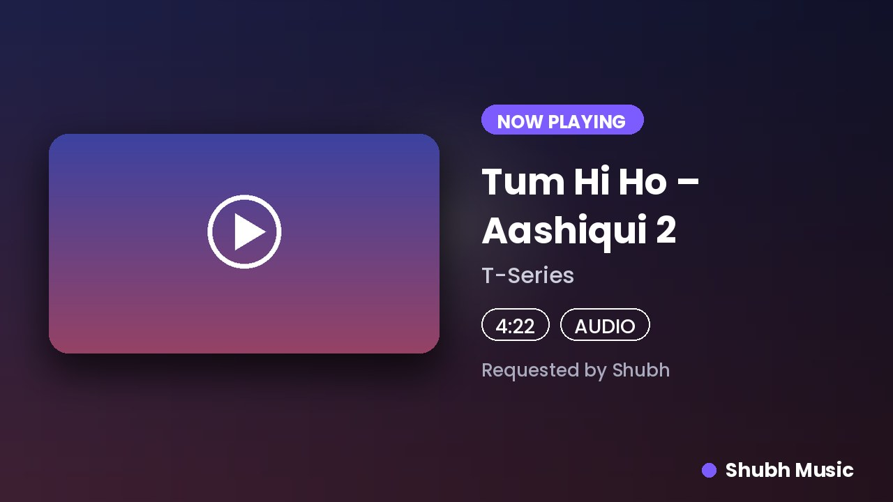

<div align="center">

# 🎧 Shubh Music: Telegram Voice-Chat Music Bot

**Play any song or video in your group's voice chat. Fast, clean, and powered by your own API.**

[](LICENSE)




</div>

---

## ✨ Why this bot

- **One simple dependency for music:** your own [YouTube API server](https://github.com/dev-shubh-madara/Yt-paid-api-bot). No YouTube API key, no scraping code inside the bot, no third-party music API.
- **Real queue system:** play, queue, force-play, loop (song or queue), shuffle, move, remove, seek, volume.
- **Coloured buttons (Telegram's newer button styles):** green = go / on, blue = navigate, red = stop / off. Pause, skip, stop, loop, shuffle, volume, ±15s seek, save to playlist, and a one-tap **📋 Link** button that copies the song link.
- **Modern message style:** expandable quotes for the queue and help, clean cards, no premium-emoji requirement, so it looks right for every user.
- **Personal playlists:** `/like` a song and replay your whole list in any group.
- **Search picker:** `/search` shows the top results as buttons, and only the person who searched can pick.
- **MP3 downloads:** `/song name` sends a real MP3 file.
- **Beautiful now-playing card:** blurred cover backdrop, rounded artwork, readable titles (English, Hindi and other scripts).
- **Careful with your API quota:** songs are resolved only when they start playing, so a queue of 50 costs nothing until it plays. Optional per-group daily cap.
- **Safe by design:** per-group admin controls, owner/sudo tools, bans, flood control, no secrets in code.
- **Self-healing:** the assistant account joins your group by itself (invite link, unban, approve join request), stuck voice chats are cleaned up, and the bot leaves when the queue ends or everyone leaves.
- **Runs anywhere:** Railway, Render, a VPS or Docker. A single SQLite file, no MongoDB or Redis to set up.

## 🧭 How it works

```
 Telegram group ──► Bot (Kurigram) ──► Player ──► your API  (/v1/search, /v1/play ...)
                         │                │
                         │                └──► Assistant account ──► py-tgcalls ──► Voice chat
                         └──► SQLite (settings, playlists, bans)
```

The **bot** takes commands. A normal Telegram account, the **assistant**, joins the voice chat and streams the audio. The **API** turns a song name or link into a streamable URL.

## 🚀 Quick start

### 1. What you need

| Item | Where to get it |
|---|---|
| `API_ID`, `API_HASH` | <https://my.telegram.org> → API development tools |
| `BOT_TOKEN` | [@BotFather](https://t.me/BotFather) → `/newbot` |
| `STRING_SESSION` | A **separate** Telegram account that acts as the assistant (see below) |
| `OWNER_ID` | Your numeric ID from [@userinfobot](https://t.me/userinfobot) |
| `API_URL`, `API_KEY` | Your deployed [Yt-paid-api-bot](https://github.com/dev-shubh-madara/Yt-paid-api-bot) and the key from its `/portal` page |

### 2. Create the assistant session

Use a second Telegram account (not your personal one). Then run:

```bash
git clone https://github.com/dev-shubh-madara/Shubh_music_public_bot-.git
cd Shubh_music_public_bot-
pip install -r requirements.txt
python session.py
```

Enter your `API_ID`, `API_HASH`, the assistant's phone number and the login code. Copy the long string it prints; that is your `STRING_SESSION`. **Treat it like a password.**

### 3. Configure

```bash
cp sample.env .env
# fill in the values
```

### 4. Run

```bash
bash start        # same as: python3 -m SHUBHMUSIC
```

Needs Python 3.12+ and `ffmpeg` installed (`sudo apt install ffmpeg`). On start-up the bot checks your API key and tells you clearly if something is wrong.

### 5. Use it in a group

1. Add the bot to your group and make it **admin** with *Invite users* and *Manage voice chats*.
2. Start a voice chat.
3. Send `/play song name`. The assistant joins automatically.

## ☁️ Deploy

### Railway (recommended)

1. Create a new project from this GitHub repo. Railway builds the included `Dockerfile`.
2. Add the variables from `sample.env` in the **Variables** tab.
3. Add a **Volume** mounted at `/app/data` so the database survives redeploys.
4. Deploy. Logs should show `Shubh Music is online as @yourbot`.

### Docker

```bash
docker build -t shubh-music .
docker run -d --name shubh-music --restart unless-stopped \
  --env-file .env -v shubh-music-data:/app/data shubh-music
```

### VPS (systemd)

Install Python 3.12 and ffmpeg, clone the repo, create a virtualenv, `pip install -r requirements.txt`, fill `.env`, and run `bash start` under systemd or `tmux`.

> ⚠️ Vercel and other serverless hosts **cannot** run this bot. It needs a process that stays alive 24/7.

## 🔑 Connecting to your API

The bot only talks to your API through two settings:

```env
API_URL=https://your-api.up.railway.app
API_KEY=myk_xxxxxxxxxxxxxxxx
```

Get the key by opening `/portal` on your API site and signing in with Google. All your bot's playback counts toward that key's daily limit, so choose a plan that fits your usage. Check it any time with `/usage` (owner only). When the limit is reached, the bot tells users when it resets.

## 📖 Commands

**Music**

| Command | What it does |
|---|---|
| `/play <name or link>` | Play now, or add to the queue (also works as a reply to a link) |
| `/play <playlist link>` | Queue a whole YouTube playlist |
| `/vplay <name or link>` | Play the **video** in the voice chat |
| `/playforce <name>` | Play right now, ahead of the queue (admins) |
| `/search <name>` | Pick from the top 5 results |
| `/song <name>` | Download as an MP3 file (works in private chat too) |

**Controls** (admins and `/auth` users by default)

| Command | What it does |
|---|---|
| `/pause`, `/resume`, `/skip`, `/stop` | Basic controls |
| `/seek 1:30`, `/seek +30`, `/seekback 15` | Jump in the song |
| `/loop [off\|song\|queue]`, `/shuffle` | Repeat and shuffle |
| `/volume 1-200` | Set volume |
| `/queue`, `/now`, `/remove n`, `/move a b`, `/clear` | Manage the queue |

**Playlists**: `/like`, `/playlist`, `/delsong n`

**Group admin**: `/settings` (who can play, who can control, clean commands), `/auth`, `/unauth`, `/authusers`, `/reload`

**Owner / sudo**: `/stats`, `/usage`, `/broadcast [-users|-groups]`, `/ban`, `/unban`, `/banned`, `/sudo`, `/unsudo`, `/sudolist`

**Anyone**: `/start`, `/help`, `/ping`

## ⚙️ Configuration

Required: `API_ID`, `API_HASH`, `BOT_TOKEN`, `STRING_SESSION`, `API_URL`, `API_KEY`. Strongly recommended: `OWNER_ID`.

| Variable | Default | Meaning |
|---|---|---|
| `STRING_SESSION2`, `STRING_SESSION3` | – | More assistants for busy bots; each group always uses the same one |
| `BOT_NAME` | `Shubh Music` | Name on the card and messages |
| `SUPPORT_CHAT`, `SUPPORT_CHANNEL` | – | Links shown on the start buttons |
| `START_IMG_URL` | – | Picture for `/start` |
| `LOG_CHAT_ID` | – | Chat that receives new-user/new-group/limit alerts |
| `DURATION_LIMIT_MIN` | `600` | Longest song allowed (minutes) |
| `MAX_QUEUE` | `50` | Max songs queued per group |
| `PLAYLIST_IMPORT_LIMIT` | `25` | Max songs taken from a playlist link |
| `AUTO_LEAVE_SECONDS` | `300` | Leave an idle or empty voice chat after this long |
| `PLAYS_PER_CHAT_PER_DAY` | `0` | Per-group daily song cap (`0` = unlimited) |
| `COMMAND_COOLDOWN_SECONDS` | `1.5` | Per-user flood control |
| `SONG_MAX_MB` | `100` | Max size of `/song` files |
| `DATA_DIR` | `data` | Where the SQLite database and bot session live |
| `TIMEZONE` | `Asia/Kolkata` | Used for the per-group daily cap reset |
| `HEALTH_SERVER`, `PORT` | `true`, host-set | Tiny `/health` endpoint for hosts that need a port |

## 🛠 Troubleshooting

| Problem | Fix |
|---|---|
| `[config] Missing required settings` | Fill every required variable. The message lists which ones are missing. |
| `The API rejected API_KEY` | Copy your key from your API's `/portal` page (if you lost it, use the rotate option there to get a new one). |
| "There is no voice chat running" | Start a voice chat in the group first. |
| "Make me an admin…" | Give the bot admin with *Invite users* and *Manage voice chats*. |
| Assistant can't join | Remove it from the group's banned list, or add it manually once. If your group uses join requests, approve it. |
| "Daily limit reached" | Your API key hit its plan limit. Upgrade the plan on your API server. |
| No sound / song skipped instantly | Check that `ffmpeg` is installed and that your API's `/health` is OK. |
| Cards show empty boxes for a language | Install a matching Noto font (the Docker image already includes common ones). |

## 🗂 Project layout

```
config.py                 all settings (read from environment variables)
sample.env                copy to .env and fill in
start / Procfile          start commands (bash start)
session.py                helper that creates STRING_SESSION
strings/                  help, welcome and other longer texts
SHUBHMUSIC/
  __main__.py             start-up and shutdown
  platforms/Youtube.py    client for your own YouTube API (search, track, playlist, stream)
  core/
    bot.py                the bot account
    userbot.py            assistant accounts + joining the group
    call.py               py-tgcalls voice-chat driver
    player.py             queue + playback logic (no Telegram code, fully testable)
    context.py            shared helpers, permissions, flood control
    notifier.py           now-playing card and status messages
  plugins/                every file here is loaded automatically
    play/                 /play /vplay /playforce
    admins/               pause, skip, stop, seek, loop, volume, auth, player buttons
    bot/                  start, help, settings, search
    tools/                queue, playlist, song (MP3), ping
    sudo/                 stats, usage, broadcast, ban, sudo
    misc/                 added to / removed from a group
  utils/
    database.py           SQLite: settings, playlists, bans, usage
    thumbnails.py         the now-playing card picture
    formatters.py         text helpers
    inline/               coloured keyboards, one file per screen
    decorators/           permission guards
    stream/queue.py       per-group queue, loop, shuffle, seek clock
tests/                    72 automated tests
```

**Looking for something?** The YouTube/API code is `SHUBHMUSIC/platforms/Youtube.py`, and the settings are in `config.py`.

## 🧪 Development

```bash
pip install -r requirements-dev.txt
pytest
```

The tests cover the queue, the player, permissions, every button and command flow, the API client, and MP3 conversion with real ffmpeg. Real Telegram connections are not part of the automated tests.

## ⚠️ Good to know

- The bot plays from **YouTube** (names, video links, playlist links). Links from other sites are politely refused.
- Respect Telegram's rules, YouTube's terms and the copyright laws of your country when you run a public bot.
- Keep `.env`, `STRING_SESSION` and `API_KEY` private. Never commit them.

## 🤝 Contributing

Issues and pull requests are welcome. Please run `pytest` before opening a PR.

## 📄 License

[MIT](LICENSE). Anyone can use, copy, modify and share this bot, for personal or commercial use, free of charge.

## 💜 Credits

Made by **[dev-shubh-madara](https://github.com/dev-shubh-madara)** (Madara Defaulter). Built with [Kurigram](https://github.com/KurimuzonAkuma/pyrogram), [py-tgcalls](https://github.com/pytgcalls/pytgcalls), [Pillow](https://python-pillow.org) and [httpx](https://www.python-httpx.org).

If this bot helps you, give the repo a ⭐
